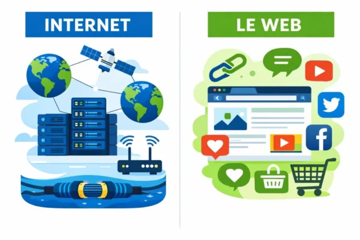

# Introduction à Internet :

Grâce à sa souplesse et à son universalité, **internet** est devenu le moyen de communication principal entre les hommes et avec les machines.

> [Vidéo d'introduction](https://youtu.be/s18KtOLpCg4)
> 

Il est important de faire la distinction entre **Internet** et le **Web**.

**Internet correspond à un réseau d'ordinateurs connectés entre eux et le Web correspond à un ensemble d'informations (site web) disponible sur Internet.**

Le Web est une des parties d'Internet 

## **Repères historiques**

> [-> Frise de l'histoire d'internet](https://view.genially.com/5ce93e682763660f3077fbc2/horizontal-infographic-timeline-snthistoireinternet)
> 

Sur internet l'échange de données entre deux ordinateurs est basé :

- le protocole **TCP/IP**
- le serveur **DNS**.
- Le **routage**
- Les **réseaux** et la communication

> Un protocole est un ensemble de règles de communication qui définissent la communication entre les ordinateurs. Chaque protocole a des règles particulières et, ensemble, ils fournissent un éventail de moyens permettant de répondre aux différents besoin d'internet.
> 

## Protocole TCP/IP

D'un point de vue technique, les protocoles TCP et IP sont au coeur d'internet.

Le sigle TCP/IP signifie «Transmission Control Protocol/Internet Protocol» et se prononce «T-C-P-I-P». Il provient des noms des deux protocoles majeurs, c’est-à-dire les protocoles TCP et IP.

💡

**Protocole**
Un protocole informatique est un ensemble de règles qui régissent les échanges de données ou le comportement collectif d’ordinateurs en réseaux ou d’objets connectés,

La suite de protocoles TCP/IP est conçue pour répondre à un certain nombre de critères parmi lesquels :

- Le fractionnement des messages en paquets
- L’utilisation d’un système d’adresses
- L’acheminement des données sur le réseau (routage)
- Le contrôle des erreurs de transmission de données

Elle est composée de plusieurs protocoles mais nous allons nous intéresser à deux d'entre eux uniquement, ceux qui donnent leur nom à la suite TCP/IP.

- **TCP (Transport Control Protocol)** conditionne les informations à transmettre en paquets de données et les transporte de bout en bout, **en veillant à ce que tout ce qui est envoyé par un ordinateur arrive à son destinataire**, indépendamment des réseaux traversés et de manière totalement transparente pour l’application.
- **IP (Internet Protocol)** assure le **routage des paquets** de manière totalement transparente pour l’utilisateur qui ne doit fournir que l’adresse Internet du destinataire

En bref Le protocole IP s'occupe d'envoyer des données à un destinatire alors que le protocole TCP est responsable de la bonne livraison de ces données. Ce sont donc deux protocoles complémentaires.

## Encapsulation

Les différentes couches du protocole TCP / IP utilisent l'encapsulation :

💡

**Encapsulation**
L'encapsulation, en informatique et spécifiquement pour les réseaux informatiques, est un procédé consistant à inclure les données d'un protocole dans un autre protocole.

Cela permet de séparer la fonction de chaque couche de communication. C'est un choix de conception modulaire.

## Protocole TCP

Quand un ordinateur A "désire" envoyer des données à un ordinateur B, après quelques opérations qui ne seront pas abordées ici, l'ordinateur A "utilise" le protocole TCP pour mettre en forme les données à envoyer.

Pour vérifier que les paquets sont bien arrivés le protocole TCP utilise une poignée de main à trois temps :

Dans le cas où un paquet n'est pas arrivé à destination, le paquet est renvoyé. **Le protocole TCP permet donc de fiabiliser la transmission (sauf en cas de panne matérielle). Cependant il ne permet de garantir la vitesse avec laquelle le paquet finira par arriver.**

## Protocole IP

Le datagramme IP est constitué d’un entête IP suivi d’un paquet contenant les données envoyées.

L’entête IP contient (entre autres) **l’adresse IP** du destinataire et de l’émetteur, ainsi que les informations pour la gestion de la fragmentation du datagramme.

Une adresse IP est un code (une adresse) qui permet la communication via internet et l’identification d’un appareil sur le réseau. Elle se présente sous la forme d’une succession de chiffres, comme `192.168.1.25`.

Le **masque de réseau** permet de définir quelle partie de l'adresse IP est celle du réseau, et quelle partie est celle de la machine. Ainsi la machine dont l'IP est 172.16.180.1 avec la masque 255.255.0.0 a pour adresse de réseau 172.16.X.X et pour adresse de machine X.X.180.1

Pour la communication avec le "monde extérieur" (via internet), votre routeur traduit les adresses privées en une adresse IP externe unique et "publique". Inversement, en cas de trafic entrant, votre routeur traduit l’adresse IP publique en adresse IP privée, en l’occurrence celle de l’appareil destinataire des données.

## Routage des paquets

Précédemment, nous avons vu qu’internet est un « réseau de réseaux ». Nous avons aussi vu que les données sont transférées d'une machine à une autre sous forme de paquet de données. Comment ces paquets de données trouvent leur chemin entre deux ordinateurs ?

### Switchs, routeurs et réseaux

Voici la représentation d’un « mini internet simplifié » :

Et voici une version plus détaillée :

Un switch :

Un routeur :

Nous avons sur ce schéma les éléments suivants :

- 15 ordinateurs : M1 à M15
- 6 switchs : R1 à R6
- 8 routeurs : A, B, C, D, E, F, G et H

Un **switch** est une sorte de « multiprise intelligente » qui permet de relier entre eux tous les ordinateurs appartenant à un même réseau, que nous appelerons "local" (nous verrons des exemples un peu plus bas). Pour ce faire, un switch est composé d’un nombre plus ou moins important de prises RJ45 femelles (un câble ethernet (souvent appelé « câble réseau ») possède 2 prises RJ45 mâles à ses 2 extrémités).

Un **routeur** permet de relier ensemble plusieurs réseaux, il est composé d’un nombre plus ou moins important d’interfaces réseau (cartes réseau). Les routeurs les plus simples que l’on puisse rencontrer permettent de relier ensemble deux réseaux (ils possèdent alors 2 interfaces réseau), mais il existe des routeurs capables de relier ensemble une dizaine de réseaux.

Evolution du débit sur internet :

Remarques :

- Différentes structures :
    - Le réseau « décentralisé » correspond au réseau téléphonique (du moins, avant qu'il ne soit numérisé).
    - Le réseau « centré » correspond (dans l'idée) à la télévision, ou à la diffusion d'un journal imprimé.
- En répondant à la dernière question, je précise que c'est une bonne illustration du métier d'ingénieur, dont le travail est de trouver la meilleure solution à un problème soumis à plusieurs contraintes incompatibles (avec comme exemple la construction d'un pont routier au dessus d'une rivière, dont on veut qu'il soit proche de la sortie d'autoroute, mais sans faire exploser le traffic dans un petit village, tout en préservant une zone naturelle protégée, en diminuant les coût au maximum pour construire un ouvrage le plus solide et durable possible…).
- Il est possible de faire le travail sur le réseau décrentralisé en classe entière (parce que c'est le plus compliqué à dessiner), puis diviser la classe en trois groupes pour travailler les suivants, avant une mise en commun. Cela permet de gagner du temps…
